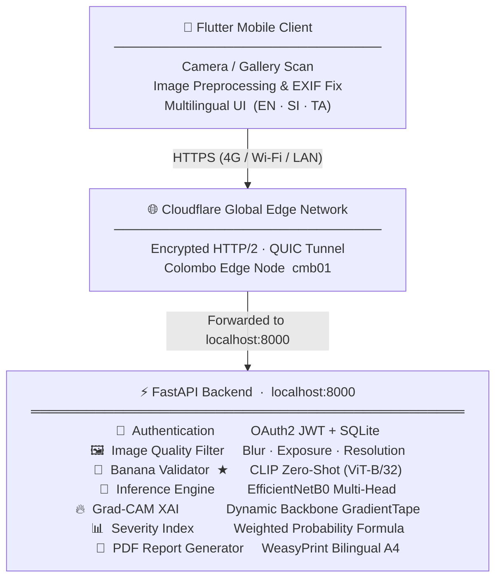
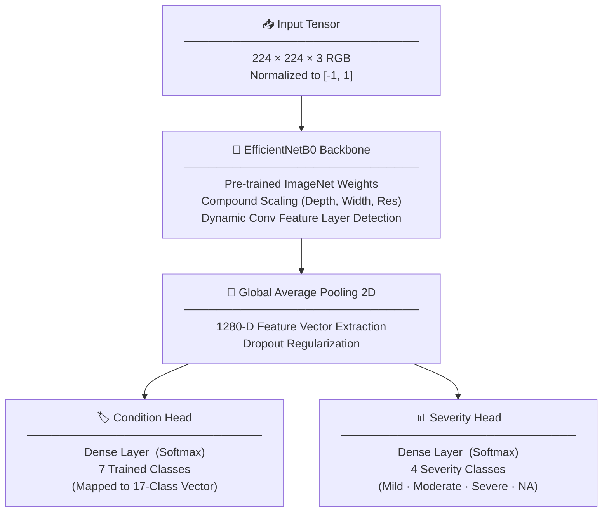
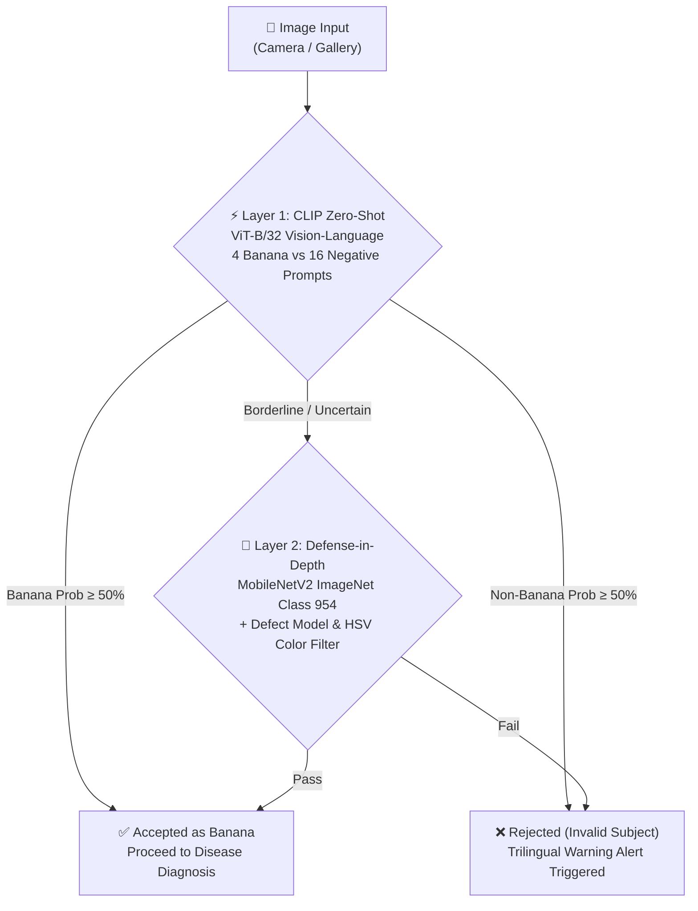
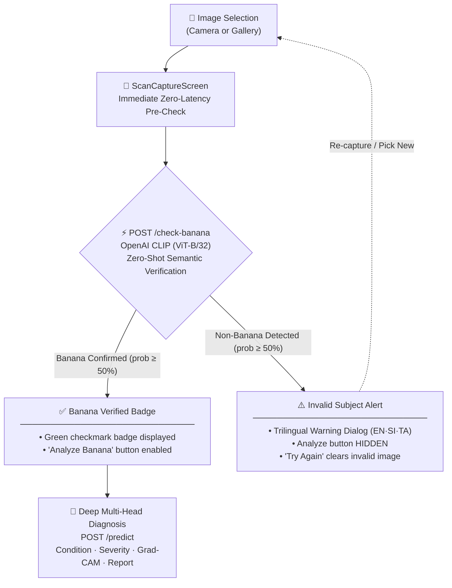

# **BananaGuard AI 🍌 🛡️**

**AI-Based Fruit Defect and Disease Detection with Severity Assessment and Disease Cause Analysis using Computer Vision Platform for Sri Lankan Banana Cultivars**
_Component 01 - R.K.M.D.V. Kulathunga (IT23288430)_

---

<div align="left">


</div>

---

## **Table of Contents**

- [1. Project Overview](#1-project-overview)
- [2. System Architecture](#2-system-architecture)
- [3. Technology Stack](#3-technology-stack)
- [4. AI Models & Research Evaluation](#4-ai-models--research-evaluation)
- [5. Project File Structure](#5-project-file-structure)
- [6. Supported Conditions](#6-supported-conditions)
- [7. Banana Subject-Matter Validation Workflow ★](#7-banana-subject-matter-validation-workflow)
- [8. Setup & Execution Guide](#8-setup--execution-guide)
- [9. Automated Testing](#9-automated-testing)
- [10. Excluded from Git (Regeneratable Files)](#10-excluded-from-git-regeneratable-files)
- [11. Ethical & Research Disclaimer](#11-ethical--research-disclaimer)

---

## **1. Project Overview**

**BananaGuard AI** is an intelligent, full-stack mobile diagnostic platform designed to assist Sri Lankan banana farmers, agricultural extension officers, and quality assurance inspectors. The system automates:

1. **Disease & Defect Classification** — Real-time identification across target conditions (fungal, bacterial, physiological defects, and pest damage) using an **EfficientNetB0 multi-head classifier**.
2. **Severity Indexing** — Multi-tier severity estimation (Mild / Moderate / Severe) via a continuous weighted severity formula (0–100 gauge).
3. **Grad-CAM Explainable AI (XAI)** — Visual saliency heatmaps highlighting exact regions influencing the model's classification, paired with automated disease bounding boxes.
4. **Zero-Shot Banana Subject-Matter Validation ★** — Vision-language validation powered by **OpenAI CLIP (ViT-B/32)** that reliably verifies banana imagery and rejects look-alikes (eggplant/brinjal, mango, pineapple, papaya, etc.) with localized trilingual alerts (EN, SI, TA).
5. **Actionable Agronomic Guidance & PDF Reports** — Contextual causes and recommendations in English, Sinhala, and Tamil, exportable as printable A4 PDF diagnostic reports.

---

## **2. System Architecture**



### End-to-End User & Diagnostic Flow

1. **Splash & Session Check** — Launch animation; restores authenticated JWT session or local guest session.
2. **Language Selection** — English (`en`), Sinhala (`si`), and Tamil (`ta`).
3. **Authentication** — Email/password login, registration, OTP password reset, or Guest mode.
4. **Home Dashboard** — Time-based greeting, quick scan FAB, recent scan history cache, scan history, server configuration.
5. **Image Acquisition** — Camera or device gallery with automatic EXIF orientation normalization.
6. **Zero-Shot Banana Validation ★** — Instant pre-check (`POST /check-banana`) using **OpenAI CLIP ViT-B/32**. Non-banana images (e.g., eggplants, mangoes, pineapples, flowers, scenery) trigger a trilingual alert dialog (EN + SI + TA) and block invalid submissions.
7. **AI Diagnostic Analysis** (`POST /predict`):
   - **Quality Check** — Non-blocking blur (Laplacian variance), exposure, and resolution advisory warnings.
   - **Condition Detection & Dynamic Confidence Indicator** — Condition identification paired with an animated confidence progress bar featuring dynamic color-coded indicators:
     - `< 50%` $\rightarrow$ **Red** (Low confidence, advisory to re-scan)
     - `50% – 75%` $\rightarrow$ **Orange** (Moderate confidence)
     - `75%+` $\rightarrow$ **Green** (High confidence, trustworthy diagnosis)
     - Accompanied by compact multilingual legend indicators (`● <50% Low`, `● 50–75% Moderate`, `● 75%+ High` in EN/SI/TA) engineered to preserve optimal screen height.
   - **Unified Severity Assessment Card** — Merged single-card UI integrating the discrete **Severity Level** badge (`Mild`, `Moderate`, `Severe`) and the continuous **Severity Index** (`0–100 Gauge`) with embedded model confidence (e.g., `84.7 / 100 (99.6%)`), eliminating redundant developer-centric scores for farmer-friendly clarity.
   - **Grad-CAM Saliency** — Interactive toggle between original image and blended heatmap overlay with bounding box.
   - **Bilingual Insights** — 3 root causes and 3 agronomic recommendations in the selected language.
   - **PDF Report** — One-tap bilingual A4 diagnostic report generation and download.
8. **History & Offline Cache** — Searchable, filterable scan history stored locally via `sqflite` and synced with backend.
9. **Dynamic Server Configuration** — Seamlessly switch between Cloudflare Tunnel and local IP without rebuilding APKs.

---

## **3. Technology Stack**

### Frontend (Flutter Mobile & Web)


| Category         | Technology                                  | Purpose                                              |
| ------------------ | --------------------------------------------- | ------------------------------------------------------ |
| Framework        | Flutter 3.x / Dart 3.x                      | Cross-platform mobile (Android/iOS) & Web client     |
| Architecture     | Clean Architecture, Feature-based modular   | High maintainability and separation of concerns      |
| State Management | Riverpod 2.6                                | Reactive state management with providers & notifiers |
| Routing          | GoRouter 14.8                               | Declarative routing with deep links & redirects      |
| Networking       | Dio 5.x                                     | HTTP client with JWT interceptor & auto-refresh      |
| Persistence      | shared_preferences & flutter_secure_storage | Encrypted token & settings persistence               |
| Local DB         | sqflite                                     | Offline scan history caching on device               |
| UI Design        | Material 3, Google Fonts                    | Outfit, Noto Sans Sinhala, Noto Sans Tamil           |
| Image Viewer     | Custom ZoomableImage widget                 | Pinch-to-zoom, pan, and Grad-CAM overlay toggle      |

### Backend (FastAPI & AI Services)


| Category        | Technology                              | Purpose                                                    |
| ----------------- | ----------------------------------------- | ------------------------------------------------------------ |
| Framework       | FastAPI 0.110+ (Python 3.10 / 3.11)     | High-performance async REST API, auto OpenAPI docs         |
| Server          | Uvicorn (ASGI)                          | Asynchronous production server                             |
| ORM & Database  | SQLAlchemy 2.0 + SQLite                 | Lightweight database layer (users, scans, OTPs)            |
| Security        | OAuth2, PyJWT (HS256), Passlib (Bcrypt) | Dual-token authentication (access + refresh)               |
| Rate Limiting   | SlowAPI                                 | Endpoint abuse protection                                  |
| PDF Engine      | WeasyPrint (Cairo, Pango, HarfBuzz)     | A4 PDF generation with complex Sinhala/Tamil glyph shaping |
| Computer Vision | OpenCV (cv2), Pillow (PIL)              | Blur/exposure checks, EXIF rotation, contour detection     |

### Machine Learning & Explainable AI (XAI)


| Category         | Technology                                                 | Details                                                |
| ------------------ | ------------------------------------------------------------ | -------------------------------------------------------- |
| Main Classifier  | **EfficientNetB0** Multi-Head (TensorFlow 2.16+ / Keras 3) | Simultaneous Condition & Severity prediction           |
| Banana Validator | **OpenAI CLIP ViT-B/32** (Transformers + PyTorch CPU)      | Semantic Zero-Shot banana vs non-banana discrimination |
| Explainability   | Grad-CAM (Gradient-weighted Class Activation Mapping)      | Dynamic backbone layer inspection + bounding box       |
| Dual Model Modes | `real` (Trained Keras model) / `demo` (SHA-256 fallback)   | Graceful offline/test fallback execution               |

### Networking — Cloudflare Tunnel

- Encrypted outbound HTTP/2 / QUIC transport to Cloudflare edge (Colombo node `cmb01`).
- Bypasses private IP, CGNAT, and port-forwarding restrictions.
- Works across 4G/5G mobile carriers, home Wi-Fi, and restrictive campus networks (SLIIT LAN/Wi-Fi).
- Real-time in-app dynamic URL configuration dialog.

---

## **4. AI Models & Research Evaluation**

### Diagnostic Classifier — EfficientNetB0 Multi-Head Architecture

The core diagnosis model uses **EfficientNetB0** transfer learning with two specialized prediction heads:

- **Condition Head**: Classifies banana disease/defect conditions.
- **Severity Head**: Predicts severity tier (`Mild`, `Moderate`, `Severe`, `NA`).



#### Empirical Model Architecture Comparison

Five candidate backbone architectures were trained and evaluated under identical preprocessing pipelines, data splits (1,290 images — 578 train / 208 val), and hyperparameters. All metrics are derived from the held-out validation split:


| Model Architecture    | Condition Accuracy | Weighted F1-Score | Severity Accuracy | Validation Loss | Mobile Suitability |  File Size  | Decision                                              |
| :---------------------- | :------------------: | :-----------------: | :-----------------: | :---------------: | :------------------: | :------------: | :------------------------------------------------------ |
| 🥇 **EfficientNetB0** |     **78.0%**     |     **76.0%**     |     **92.3%**     |     **0.9**     |      **Good**      | **~50.7 MB** | ✅ **Selected — Best Overall Performance**           |
| MobileNetV2           |       63.0%       |       64.0%       |       74.5%       |       1.7       |     Excellent     |   ~30.0 MB   | 🥈 Runner-up; lower severity accuracy                 |
| DenseNet121           |       62.0%       |       65.0%       |       68.3%       |       1.8       |       Medium       |   ~84.6 MB   | Lower condition & severity accuracy                   |
| ResNet50V2            |       48.0%       |       54.0%       |       81.2%       |       1.8       |       Medium       |  ~276.0 MB  | ❌ Severe overfitting; oversized for mobile           |
| EfficientNetV2B0      |       25.0%       |       34.0%       |       69.7%       |       2.2       |     Very good     |   ~72.1 MB   | ❌ Catastrophic fine-tuning collapse; lowest accuracy |

> **Dataset:** 1,290 images across 7 condition classes · 4 severity classes · Training Split: 44.8% Train / 16.1% Val (validation subset reported above)

**Key Research Findings:**

1. **EfficientNetB0 🏆** achieved the highest overall performance with **78% condition accuracy** and **92.3% severity accuracy**, outperforming all other evaluated backbones across every metric. Its weighted F1-score of **0.76 / 0.92** confirms robust, balanced class prediction beyond simple accuracy.
2. **MobileNetV2** (63% / 74.5%) and **DenseNet121** (62% / 68.3%) served as moderate-performance baselines, offering acceptable results but falling significantly short on severity detection — the most clinically critical metric for agronomic dosage guidance.
3. **ResNet50V2** (48% / 81.2%) suffered from severe overfitting, and its **~276 MB** footprint makes mobile deployment impractical.
4. **EfficientNetV2B0** (25% / 69.7%) experienced catastrophic fine-tuning collapse, achieving the lowest condition accuracy of all candidates despite a reasonable file size (**~72.1 MB**).
5. EfficientNetB0's compound scaling (depth × width × resolution) delivers the optimal accuracy-to-efficiency trade-off, producing a compact **~50.7 MB** model with **Validation Loss of only 0.9** — the lowest of all architectures — making it ideal for mobile-assisted edge inference in agricultural field conditions.

#### Continuous Severity Index Formula

Instead of raw discrete classes alone, BananaGuard AI computes a continuous 0–100 gauge index using weighted probabilities from the severity head:

$$
\text{Severity Index} = (P_{\text{mild}} \times 20) + (P_{\text{moderate}} \times 50) + (P_{\text{severe}} \times 85)

$$

Where $P_{\text{mild}}$, $P_{\text{moderate}}$, and $P_{\text{severe}}$ are softmax probabilities. The resulting score is clamped to $[0, 100]$.

#### Diagnostic Metric System: Condition Confidence vs. Severity Assessment

To eliminate diagnostic confusion between model certainty and crop damage intensity, BananaGuard AI clearly decouples classification metrics from physical severity:


| Diagnostic Metric          | Clinical Question Answered             | Measurement Scope                                                                   | UI Presentation & Dynamic Color Coding                                                                                                                                                                                                                        | Practical Agronomic Action                                                                          |
| :--------------------------- | :--------------------------------------- | :------------------------------------------------------------------------------------ | :-------------------------------------------------------------------------------------------------------------------------------------------------------------------------------------------------------------------------------------------------------------- | :---------------------------------------------------------------------------------------------------- |
| **Condition Confidence**   | _"What condition/defect is this?"_     | Model classification certainty for the predicted class (0–100%)                    | **Animated Progress Bar** with dynamic threshold coloring & compact legend:• **< 50% Red** (`Low` / `අඩු` / `குறைவு`)• **50–75% Orange** (`Moderate` / `මධ්‍යම` / `மிதமானது`)• **75%+ Green** (`High` / `ඉහළ` / `அதிகம்`) | Informs whether to trust the diagnostic output or retake the scan if confidence is below threshold. |
| **Severity Level & Index** | _"How severe is the physical damage?"_ | Pathological damage magnitude on the banana fruit surface (0–100 continuous index) | **Unified Assessment Card** with discrete badge (`Mild` / `Moderate` / `Severe`) and continuous animated gauge with model confidence (e.g., `84.7 / 100 (99.6%)`):• **0–35 Mild** (Green)• **35–70 Moderate** (Amber)• **70–100 Severe** (Red)          | Directs treatment urgency, agronomic dosage intensity, and harvest segregation decisions.           |

---

### Zero-Shot Banana Subject-Matter Validator ★

Traditional ImageNet classifiers (e.g., MobileNetV2 class 954) often fail to reject visually similar produce such as **eggplants / brinjal (elongated shape)**, **mangoes (yellow/green skin)**, or **pineapples**.

BananaGuard AI employs a **Zero-Shot Vision-Language Classifier** powered by **OpenAI CLIP (ViT-B/32)**:

- **4 Banana Prompts**: Fresh bananas, green/ripe bananas, rotted/diseased black bananas, banana bunches on stalk.
- **16 Precise Negative Prompts**: Eggplants/brinjal, mangoes, pineapples, papayas, citrus fruits, avocados, vegetables, cooked food, flowers, temples/stupas, buildings, persons, vehicles, digital screens, furniture.
- **Multi-Layer Defense Pipeline**:



---

## **5. Project File Structure**

```
BananaGuard AI/
├── .env                            # Environment variables (API keys, secrets — not committed)
├── .flutter-plugins-dependencies   # Flutter plugin dependency graph (auto-generated)
├── .gitignore                      # Root gitignore (models, database, caches, builds)
├── .metadata                       # Flutter project metadata
├── analysis_options.yaml           # Dart analyzer & linter rules
├── docker-compose.yml              # Containerized multi-service deployment
├── Dockerfile                      # Root-level production container definition
├── l10n.yaml                       # Flutter localization (ARB / intl) configuration
├── pubspec.lock                    # Resolved dependency locks
├── pubspec.yaml                    # Flutter dependencies & assets config
├── README.md                       # Complete research & setup documentation
├── render.yaml                     # Render.com cloud deployment configuration
├── START_SYSTEM.bat                # One-click Windows launcher for FastAPI backend
│
├── .github/                        # GitHub Actions CI/CD workflows & issue templates
├── .idea/                          # JetBrains / Android Studio IDE project settings
├── .vscode/                        # VS Code IDE workspace configuration
│
├── android/                        # Android native platform project
├── ios/                            # iOS native platform project
├── linux/                          # Linux desktop native runner
├── macos/                          # macOS desktop native runner
├── web/                            # Web platform runner
├── windows/                        # Windows native desktop runner
│
├── assets/                         # App icons, illustrations, and multilingual fonts
├── storage/                        # Root-level runtime storage (scans, reports, etc.)
├── test/                           # Automated Flutter test suite (26/26 passing)
│
├── lib/                            # Flutter Dart application code
│   ├── main.dart                   # Entrypoint & local storage initialization
│   ├── app.dart                    # MaterialApp & Material 3 theme definitions
│   ├── core/                       # API client, route definitions, constants
│   ├── models/                     # ScanResult, UserModel, ConditionInfo
│   ├── providers/                  # Riverpod State Notifiers (Scan, Auth, History)
│   ├── services/                   # HTTP API services & local sqflite database
│   ├── screens/                    # 18 feature screens (Capture, Result, History, Settings)
│   └── widgets/                    # SeverityGauge, CreativeProgressBar, ZoomableImage, etc.
│
└── backend/
    └── identification_api/         # Identification API (FastAPI AI Engine)
        ├── app/                    # Application package (routers, services, db, schemas)
        ├── data/                   # Data assets & agronomic knowledge base
        ├── docs/                   # API and architectural documentation
        ├── tests/                  # Automated test suite (pytest - 13/13 passing)
        ├── ml/                     # Machine learning models & training scripts
        ├── storage/                # Runtime data & scan images
        ├── .env.example            # Environment variables template
        ├── .gitignore              # Backend ignore rules
        ├── Dockerfile              # Backend container definition
        ├── README.md               # Identification API guide
        └── requirements.txt        # Python dependencies (TensorFlow, PyTorch CPU, etc.)
```

---

## **6. Supported Conditions**

### Target Conditions

> **Dataset Note:** Images were collected across multiple Sri Lankan banana varieties (Ambul, Kolikuttu, Rath Kesel, Seeni Kesel, etc.) to ensure variety-agnostic robustness. The model is trained to detect **disease/defect conditions only** — variety is not a classification target.


| #  | Condition ID         | Category | English Name       | Sinhala Name                                 |
| :--- | :--------------------- | :--------- | :------------------- | :--------------------------------------------- |
| 0  | `healthy`            | Healthy  | Healthy Banana     | නිරෝගී කෙසෙල්                    |
| 1  | `anthracnose`        | Disease  | Anthracnose        | ඇන්ත්‍රැක්නෝස් රෝගය        |
| 2  | `crown_rot`          | Disease  | Crown Rot          | කිරුළ කුණුවීම                    |
| 3  | `finger_rot`         | Disease  | Finger Rot         | ඇඟිලි කුණුවීම                    |
| 4  | `black_end_rot`      | Disease  | Black End Rot      | කළු අග කුණුවීම                   |
| 5  | `bacterial_soft_rot` | Disease  | Bacterial Soft Rot | බැක්ටීරියා මෘදු කුණුවීම |
| 6  | `fusarium_rot`       | Disease  | Fusarium Rot       | ෆියුසාරියම් කුණුවීම        |
| 7  | `bruising`           | Defect   | Bruising           | තැලීම්                                 |
| 8  | `physical_damage`    | Defect   | Physical Damage    | යාන්ත්‍රික හානි                |
| 9  | `black_spots`        | Defect   | Black Spots        | කළු ලප                                  |
| 10 | `scarring`           | Defect   | Scarring           | කැළැල්                                 |
| 11 | `skin_splitting`     | Defect   | Skin Splitting     | පොත්ත පැළීම                        |
| 12 | `insect_damage`      | Defect   | Insect Damage      | කෘමි හානි                            |
| 13 | `deformation`        | Defect   | Deformation        | විකෘතිතා                             |
| 14 | `wrinkling`          | Defect   | Wrinkling          | රැලි වැටීම                          |
| 15 | `sunburn`            | Defect   | Sunburn            | හිරු එළියෙන් පිළිස්සීම   |
| 16 | `sap_latex_stain`    | Defect   | Sap / Latex Stain  | කිරි පැල්ලම්                      |

---

## **7. Banana Subject-Matter Validation Workflow ★**



### Trilingual Alert Dialog


| Language    | Dialog Title                                         | Dialog Message                                                                                                                                                                                                                                              | Primary Action                                  |
| :------------ | :----------------------------------------------------- | :------------------------------------------------------------------------------------------------------------------------------------------------------------------------------------------------------------------------------------------------------------ | :------------------------------------------------ |
| **English** | `Banana Image Required`                              | _"This app only supports banana fruit images. Please capture or select a clear photo of a banana and try again."_                                                                                                                                           | `Try Again`                                     |
| **Sinhala** | `කෙසෙල් ඡායාරූපයක් අවශ්‍යයි` | _"මෙම app එකෙහි කෙසෙල් පළතුරු පමණක් scan කළ හැකිය. කරුණාකර කෙසෙල් ගෙඩියක ඡායාරූපයක් ගෙන නැවත උත්සාහ කරන්න."_                                                                 | `නැවත උත්සාහ කරන්න`              |
| **Tamil**   | `வாழைப்பழ படம் தேவை`                 | _"இந்த app இல் வாழைப்பழ படங்கள் மட்டுமே ஸ்கேன் செய்யலாம். தயவுசெய்து வாழைப்பழத்தின் தெளிவான புகைப்படம் எடுத்து மீண்டும் முயற்சிக்கவும்."_ | `மீண்டும் முயற்சிக்கவும்` |

---

## **8. Setup & Execution Guide**

### Prerequisites

- **Python**: 3.10 or 3.11
- **Flutter SDK**: 3.22+ (configured in system PATH)
- **Android Device** or **Google Chrome** (for Web testing)

---

### Step 1 — Environment & Backend Setup (First Time Only)

```bash
# 1. Ensure .env file exists at project root (copy from .env.example)
copy .env.example .env        # Windows CMD / PowerShell
# cp .env.example .env        # Linux / macOS

# 2. Navigate to backend directory
cd backend/identification_api

# 3. Create virtual environment
python -m venv .venv

# 4. Activate virtual environment
.venv\Scripts\activate        # Windows PowerShell / CMD
# source .venv/bin/activate   # Linux / macOS

# 5. Install Python dependencies
pip install -r requirements.txt
```

> **Note on Model Weights**:
>
> - Diagnostic Model: `bananaguard_model.keras` (~50.7 MB, EfficientNetB0) is **included in the repository** at `backend/identification_api/ml/`. No separate download needed — it is within GitHub's 100 MB file size limit.
> - CLIP Zero-Shot (ViT-B/32): downloaded automatically from HuggingFace on first launch, cached for offline execution.

---

### Step 2 — Run Backend (FastAPI Server)

**Terminal 1** — Open at project root:

```powershell
# Navigate to backend directory
cd backend\identification_api

# Activate virtual environment
.venv\Scripts\activate

# Launch FastAPI development server
uvicorn app.main:app --host 0.0.0.0 --port 8000 --reload
```

- ✅ API Base URL: `http://127.0.0.1:8000` (or `http://localhost:8000`)
- ✅ Interactive OpenAPI Docs (Swagger UI): `http://127.0.0.1:8000/docs`
- ✅ ReDoc: `http://127.0.0.1:8000/redoc`

---

### Step 3 — Run Frontend (Flutter Web on Google Chrome)

**Terminal 2** — Open at project root:

```powershell
# 1. Fetch Flutter dependencies (first time only)
flutter pub get

# 2. Launch web app in Google Chrome
flutter run -d chrome
```

> **💡 Connecting Frontend to Backend in Chrome:**
>
> 1. Once Chrome opens, go to the **Sign In** screen.
> 2. Click the **"Change Server URL"** button / icon.
> 3. Enter `http://localhost:8000` (or `http://127.0.0.1:8000`) and click **Save**.
> 4. You can now register/login or proceed in **Guest Mode** to test scans directly from your browser!

---

### Step 4 — Optional: One-Click System Launcher (Windows)

To start the FastAPI backend **and** expose it as a public HTTPS Cloudflare Tunnel with a single click:

```powershell
# Run from project root (or double-click the file):
.\START_SYSTEM.bat
```

- Automatically activates Python `.venv`.
- Launches FastAPI server on port 8000.
- Establishes Cloudflare tunnel and generates a public HTTPS link (e.g., `https://xxxx.trycloudflare.com`).
- Perfect for testing on physical smartphones without local network constraints.

---

### Step 5 — Inspect Database & Scans

To view users, scan records, and OTP entries stored in the database:

```powershell
# Run from project root (or double-click):
.\view_database.bat
```

Or via Python directly:

```powershell
backend\identification_api\.venv\Scripts\python.exe view_db.py
```

---

### Step 6 — Mobile Device Execution (Optional)

**Android Device via USB:**

```powershell
flutter run -d android
```

**Build Production Release APK:**

```powershell
flutter build apk --release
# Generated APK: build/app/outputs/flutter-apk/app-release.apk
```

---

## **9. Automated Testing**

### Backend Unit & Integration Tests (pytest)

```bash
cd backend/identification_api
pytest tests -v
```

_13 / 13 test suites passing:_

- Severity weighted index calculation & boundary clamping
- Agronomic knowledge base schema and multilingual integrity
- OAuth2 dual-token lifecycle & refresh flows
- Image quality validator and inference schemas

### Frontend Unit & Widget Tests (Flutter)

```bash
flutter test
```

_26 / 26 test suites passing:_

- Multilingual time-based greeting resolution
- Diagnostic response parsing and JSON serialization
- Severity gauge animation and coloring
- Navigation guards and session restoration

---

## **10. Excluded from Git (Regeneratable Files)**

The following files and folders are listed in `.gitignore` because they are either **too large for GitHub**, **auto-generated at runtime**, or **recreatable with a single command**. They are **not committed to the repository**.


| Path                                                    | Reason                                                                                 | How to Restore                                                |
| :-------------------------------------------------------- | :--------------------------------------------------------------------------------------- | :-------------------------------------------------------------- |
| `backend/identification_api/.venv/`                     | Python virtual environment (~2.98 GB)                                                  | `python -m venv .venv` then `pip install -r requirements.txt` |
| `build/`                                                | Flutter build output (~1.96 GB)                                                        | `flutter build apk`                                           |
| `.dart_tool/`                                           | Dart/Flutter tool cache (~247 MB)                                                      | `flutter pub get`                                             |
| `backend/identification_api/ml/bananaguard_model.keras` | Trained EfficientNetB0 model (~50.7 MB) — included in Git (under 100 MB GitHub limit) | Already in repository — no action needed                     |
| `backend/identification_api/storage/*.pdf`              | Generated PDF diagnostic reports                                                       | Auto-created when a report is requested                       |
| `backend/identification_api/storage/*.png`              | Generated report page images                                                           | Auto-created at runtime                                       |
| `*.db` / `*.sqlite`                                     | SQLite database files                                                                  | Auto-created by SQLAlchemy on first backend start             |
| `__pycache__/`, `*.pyc`                                 | Python bytecode cache                                                                  | Auto-generated by Python                                      |

> **After cloning this repository**, run the following to restore the environment before starting:
>
> ```powershell
> # Backend
> cd backend/identification_api
> python -m venv .venv
> .venv\Scripts\activate
> pip install -r requirements.txt
>
> # Flutter
> cd ../..
> flutter pub get
> ```
>
> The trained model (`bananaguard_model.keras`) is **included in the repository** and requires no separate download.

---

## **11. Ethical & Research Disclaimer**

BananaGuard AI is an automated decision-support system designed for undergraduate research and agricultural extension advisory assistance. Automated diagnostic outputs and chemical treatment recommendations should be verified by certified agricultural officers before undertaking large-scale crop interventions.
