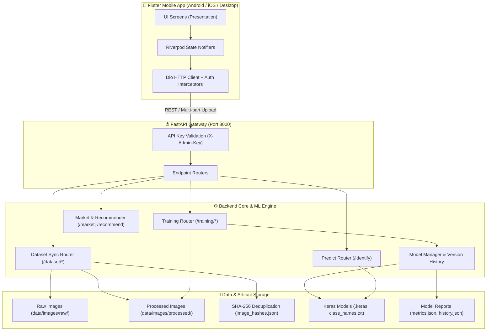

# 🍌 AgriExport AI: Fruit Variety Identification & Export Intelligence System

[](https://flutter.dev)
[](https://python.org)
[](https://fastapi.tiangolo.com)
[](https://tensorflow.org)
[](#project-architecture)

An end-to-end intelligent computer-vision and decision-support platform designed to assist fruit exporters, quality assurance teams, and agricultural supply-chain managers. The system automates **banana cultivar classification**, **dataset ingestion with CLAHE preprocessing & deduplication**, **on-device & server-side retraining**, **model version governance**, and **global market export suitability analysis**.

---

## 📑 Table of Contents

1. [System Architecture](#-system-architecture)
2. [Key Capabilities](#-key-capabilities)
3. [Repository Structure](#-repository-structure)
4. [Tech Stack & Prerequisites](#-tech-stack--prerequisites)
5. [Backend Setup & Execution](#-backend-setup--execution)
6. [Mobile App Setup & Execution](#-mobile-app-setup--execution)
7. [ML Pipeline & Training Lifecycle](#-ml-pipeline--training-lifecycle)
8. [Evaluation Metrics & Model Governance](#-evaluation-metrics--model-governance)
9. [API Endpoint Reference](#-api-endpoint-reference)
10. [Hardware Throttling & Concurrency Safeguards](#-hardware-throttling--concurrency-safeguards)
11. [Troubleshooting & Common Fixes](#-troubleshooting--common-fixes)

---

## 🏛 System Architecture

The platform follows a decoupled, client-server architecture with strict hardware resource controls and asynchronous pipeline isolation:



---

## 🚀 Key Capabilities

### 1. Multi-Cultivar Banana Identification
- Automatically identifies 6 primary banana cultivars:
  - **Ambul** (*Musa acuminata*)
  - **Ambun** (*Cavendish*)
  - **Anamalu**
  - **Kolikuttu** (*Silk*)
  - **Red Banana** (*Musa acuminata 'Red Dacca'*)
  - **Seeni** (*Pisang Awak*)
- Returns top-1 prediction with confidence percentage, top-3 alternate varieties, inference latency, and timestamp.

### 2. Automated Raw Dataset Ingestion & Preprocessing
- **SHA-256 Deduplication**: Generates deterministic image digests to prevent identical images from contaminating train/validation sets.
- **Smart Aspect-Ratio White-Padding**: Resizes non-square inputs to $224 \times 224$ while preserving geometric aspect ratios without image warping.
- **CLAHE Enhancement**: Applies Contrast Limited Adaptive Histogram Equalization on luminance channels to normalize harsh orchard lighting and deep field shadows.
- **Synthetic Background Augmentation**: Composites isolated fruit masks against realistic export backgrounds (packing facilities, crates, plain boards) to prevent background bias overfitting.

### 3. Continuous Model Retraining & Admin Governance
- In-app **Model Control Center** allows administrators to:
  - Trigger dataset synchronizations in the background with live progress tracking.
  - Run continuous retraining jobs across multiple base architectures:
    - **MobileNetV2** (high-efficiency edge deployment)
    - **DenseNet121** (high-capacity deep feature representation)
    - **Fine-Tuning Strategies** (Feature extractor freezing followed by deep unfreezing)
  - View full version archives (`v0001`, `v0002`, ...) with side-by-side comparison.
  - Pin, roll back, or promote any historical model version to the active serving model with 1 click.

### 4. Interactive Performance Reports & Metric Visualizations
- Interactive training curves (Epoch Loss vs Epoch Accuracy for both Train and Validation).
- Full confusion matrix heatmaps showing exact cross-cultivar classification boundaries.
- Per-class breakdown of **Precision**, **Recall**, and **F1-Score**.
- Summary benchmarks: **Macro F1**, **Micro F1**, and **Weighted F1**.

### 5. Market Export Suitability Recommender
- Cross-references classified variety against global import regulations and demand matrices (EU, Middle East, Asia-Pacific, UK, North America).
- Evaluates grade standards, optimal transport conditions, required certifications (GlobalG.A.P., Phytosanitary), and tariff structures.

---

## 📂 Repository Structure

```
research_project/
├── backend/
│   └── identification_api/
│       ├── app/
│       │   ├── main.py                  # FastAPI application entrypoint & middleware
│       │   ├── schemas.py               # Pydantic request/response validation schemas
│       │   ├── routers/
│       │   │   ├── predict.py           # Fruit classification endpoint (/identify)
│       │   │   ├── training.py          # Background training trigger, progress & logs
│       │   │   ├── dataset.py           # Raw image directory synchronization & stats
│       │   │   ├── models.py            # Version comparison, rollback, and pin endpoints
│       │   │   ├── alerts.py            # Dataset alerts (unbalanced classes, low counts)
│       │   │   └── recommend.py         # Country-specific export suitability logic
│       │   ├── ml/
│       │   │   ├── training/
│       │   │   │   ├── train_pipeline.py# Full pipeline: data loader, augmentation, fit, eval
│       │   │   │   └── model_factory.py # MobileNetV2, DenseNet121 constructors
│       │   │   ├── sync_raw.py          # SHA-256 deduplication and CLAHE image preprocessing
│       │   │   ├── report.py            # Evaluation metrics and classification report generator
│       │   │   ├── model/               # Production serving model (.keras) & class_names.txt
│       │   │   └── model_versions/      # Archived model runs (weights, metrics, plots)
│       │   └── market/                  # Market data parsers & country criteria engines
│       ├── data/                        # Image storage, CSV matrices, index mappings
│       ├── docs/                        # Technical guides, evaluation formulas, architectural docs
│       ├── tests/                       # Pytest test suites (phases A-D, augmentations)
│       ├── .env                         # Server limits, CPU/GPU throttling, and secrets
│       └── requirements.txt             # Backend dependencies
│
├── lib/
│   ├── app/
│   │   ├── app.dart                     # MaterialApp wrapper, theme bindings
│   │   └── router.dart                  # GoRouter declarative navigation tree
│   ├── core/
│   │   ├── config/app_config.dart       # Base URLs, API keys, network timeouts
│   │   ├── network/api_client.dart      # Dio HTTP wrapper with automated error handling
│   │   └── theme/app_theme.dart         # Colors, typography, and card stylings
│   ├── features/
│   │   ├── home/                        # Root navigation dashboard
│   │   ├── identification/              # Primary banana vision feature
│   │   │   ├── data/                    # Services, API clients, and DTO parsing
│   │   │   └── presentation/screens/
│   │   │       ├── identification_screen.dart   # Camera & image analysis UI
│   │   │       ├── admin_model_center_screen.dart # Retraining trigger & version management
│   │   │       ├── model_report_screen.dart     # FL Chart graphs & confusion matrix
│   │   │       ├── export_recommendation_screen.dart # Market & country readiness
│   │   │       ├── dataset_training_screen.dart # Dataset stats & sync controller
│   │   │       ├── market_trends_screen.dart    # Export pricing & global demand
│   │   │       └── alerts_screen.dart           # Dataset imbalance and pipeline alerts
│   │   ├── defect_detection/            # Fruit surface defect and quality module
│   │   ├── shelf_life/                  # Ripeness stage and shelf-life prediction
│   │   └── traceability/                # Farm-to-packhouse batch traceability
│   ├── shared/                          # Reusable UI widgets (buttons, loaders, pickers)
│   └── main.dart                        # Flutter application entry point
├── pubspec.yaml                         # Flutter dependencies & asset declarations
└── README.md                            # Main project documentation (this file)
```

---

## 🛠 Tech Stack & Prerequisites

### Frontend (Mobile App)
- **Framework**: [Flutter 3.13.4+](https://flutter.dev) (Dart SDK `^3.13.4`)
- **State Management**: [Riverpod `^3.4.3`](https://riverpod.dev)
- **Routing**: [GoRouter `^18.0.2`](https://pub.dev/packages/go_router)
- **Networking**: [Dio `^5.11.1`](https://pub.dev/packages/dio)
- **Data Visualizations**: [fl_chart `^1.2.0`](https://pub.dev/packages/fl_chart)
- **Media Handling**: [image_picker `^1.2.4`](https://pub.dev/packages/image_picker), [file_picker `^13.1.0`](https://pub.dev/packages/file_picker)

### Backend (Inference & Training Service)
- **Runtime**: [Python 3.12](https://python.org)
- **Framework**: [FastAPI](https://fastapi.tiangolo.com) with [Uvicorn](https://www.uvicorn.org)
- **Deep Learning**: [TensorFlow / Keras 2.15+](https://tensorflow.org)
- **Computer Vision**: [OpenCV (`cv2`)](https://opencv.org), [Pillow (`PIL`)](https://python-pillow.org)
- **Metrics & Science**: [Scikit-Learn](https://scikit-learn.org), [NumPy](https://numpy.org), [Pandas](https://pandas.pydata.org)
- **Hardware Acceleration**: NVIDIA CUDA Toolkit & cuDNN (optional, CPU fallback fully supported)

---

## 💻 Backend Setup & Execution

### 1. Clone & Navigate to Backend
```powershell
cd "d:\Y4S1\Research Project\app\research_project\backend\identification_api"
```

### 2. Initialize Virtual Environment
```powershell
# Create virtual environment
python -m venv venv

# Activate on Windows PowerShell:
.\venv\Scripts\Activate.ps1
```

### 3. Install Dependencies
```powershell
pip install --upgrade pip
pip install -r requirements.txt
```

### 4. Configure Environment Variables
Create or verify `.env` in `backend/identification_api/.env`:
```env
ADMIN_API_KEY=testkey
RETRAIN_THRESHOLD=10
MIN_IMAGES_PER_CLASS=30
MIN_PROMOTE_ACCURACY=0.80

# Hardware Throttling Limits
CPU_USAGE_LIMIT_PERCENT=35
GPU_USAGE_LIMIT_PERCENT=60
MAX_SYNC_WORKERS=4
TF_INTRA_OP_THREADS=4
TF_INTER_OP_THREADS=2
CUDA_VISIBLE_DEVICES=0
GPU_MEMORY_LIMIT_MB=3686
```

### 5. Launch FastAPI Service
```powershell
python -m uvicorn app.main:app --host 0.0.0.0 --port 8000 --reload
```
- **Interactive Swagger Documentation**: [http://localhost:8000/docs](http://localhost:8000/docs)
- **ReDoc Interactive Reference**: [http://localhost:8000/redoc](http://localhost:8000/redoc)

---

## 📱 Mobile App Setup & Execution

### 1. Navigate to Project Root
```powershell
cd "d:\Y4S1\Research Project\app\research_project"
```

### 2. Configure Backend Host
Open [`lib/core/config/app_config.dart`](file:///d:/Y4S1/Research%20Project/app/research_project/lib/core/config/app_config.dart) and configure the host URL based on your target device:
- **Android Emulator**: `http://10.0.2.2:8000`
- **Physical Mobile Device**: `http://<YOUR_LOCAL_PC_IP>:8000` (e.g. `http://192.168.1.100:8000`)
- **Windows Desktop / Web**: `http://127.0.0.1:8000`

### 3. Install Packages & Run
```powershell
# Fetch dependencies
flutter pub get

# Check attached devices
flutter devices

# Run application (example: targeting Android)
flutter run
```

---

## 🧠 ML Pipeline & Training Lifecycle

```
[Raw Image Folder]
       │
       ▼
[SHA-256 Hash Verification] ──(Duplicate detected)──► [Skipped & Logged]
       │
       ▼ (Unique image)
[Aspect-Preserving Resize + White-Padding (224x224)]
       │
       ▼
[CLAHE Illumination Normalization & Denoising]
       │
       ▼
[Processed Image Archive]
       │
       ├──► 80% Stratified Split ──► [On-The-Fly Augmentation] ──► [Training Batches]
       ├──► 10% Stratified Split ──► [Validation Set]
       └──► 10% Stratified Split ──► [Test Set (Unseen Benchmark)]
                                              │
                                              ▼
                                 [Final Metric Evaluation]
                                              │
                                              ├── Acc >= Threshold? ──► [Promote to Active Model]
                                              └── Acc < Threshold?  ──► [Archive as Version Run Only]
```

### Ingestion CLI
You can synchronize the dataset via command-line or the Admin UI:
```powershell
# Perform dry run check
python -m app.ml.sync_raw --dry-run

# Process a specific class
python -m app.ml.sync_raw --class Ambul_Banana

# Run full parallel sync
python -m app.ml.sync_raw
```

---

## 📊 Evaluation Metrics & Model Governance

All training runs calculate standardized performance metrics on an isolated test set. The mathematical formulation and code mappings are listed below:

| Metric | Formulation | Practical Meaning in Cultivar Context | Code Mapping |
| :--- | :--- | :--- | :--- |
| **Test Accuracy** | $\frac{TP + TN}{Total}$ | Overall percentage of test banana images classified correctly. | `train_pipeline.py:960` |
| **Precision** | $\frac{TP}{TP + FP}$ | When the model flags an image as *Ambul*, how often is it truly *Ambul*? (Controls false alarms). | `train_pipeline.py:962` |
| **Recall** | $\frac{TP}{TP + FN}$ | Out of all real *Kolikuttu* bananas, how many did the model capture? (Controls missed varieties). | `train_pipeline.py:962` |
| **F1-Score** | $2 \cdot \frac{P \cdot R}{P + R}$ | The harmonic balance between Precision and Recall for a specific cultivar. | `train_pipeline.py:962` |
| **Macro F1** | $\frac{1}{N}\sum F1_i$ | Arithmetic average of all class F1s; gives equal weight to rare and abundant cultivars. | `train_pipeline.py:961` |
| **Micro F1** | $\frac{\sum TP}{\sum(TP + FP)}$ | Aggregate metric across all classes. Equal to overall accuracy in single-label tasks. | `train_pipeline.py:960` |
| **Weighted F1** | $\sum w_i F1_i$ | Average of class F1s weighted by the number of ground-truth test instances. | `train_pipeline.py:962` |
| **Loss Curves** | Categorical Cross-Entropy | Penalty metric tracked across training & validation epochs to detect overfitting. | `train_pipeline.py:910` |
| **Confusion Matrix** | $N \times N$ Grid | Direct cross-tabulation showing exact misclassification pairs (e.g., Ambul vs. Ambun). | `train_pipeline.py:965` |

---

## 🔌 API Endpoint Reference

| Method | Endpoint | Description | Access |
| :--- | :--- | :--- | :--- |
| `POST` | `/identify` | Multipart upload of banana image; returns top predictions & confidence | Public |
| `GET` | `/dataset/stats` | Class image counts, raw vs. processed breakdown, duplicate counts | Public |
| `POST` | `/dataset/sync` | Starts background thread to hash, pad, and CLAHE-normalize raw images | Admin Key |
| `GET` | `/dataset/sync/status` | Real-time progress, processed counts, and elapsed time | Public |
| `POST` | `/training/retrain` | Triggers asynchronous retraining job (MobileNetV2 / DenseNet121) | Admin Key |
| `GET` | `/training/status` | Current training stage, epoch progress, ETA, and live metrics | Public |
| `GET` | `/training/versions` | List of all historical model runs (`v0001`, `v0002`, ...) | Public |
| `POST` | `/training/rollback` | Promotes a previous model version to active production serving | Admin Key |
| `GET` | `/training/report/active`| Full evaluation report, confusion matrix, and training curves of active model | Public |
| `GET` | `/alerts` | Flags classes with fewer than 30 images or severe class imbalance | Public |
| `POST` | `/recommend` | Returns export country recommendations based on cultivar and grade | Public |

---

## ⚡ Hardware Throttling & Concurrency Safeguards

To prevent background jobs from locking the host OS during heavy computer vision workloads:

1. **CPU Clamping**:
   - Training and image sync workers are restricted using `TF_INTRA_OP_THREADS=4` and `TF_INTER_OP_THREADS=2`.
   - Batch multiprocessing pools are capped at 4 worker threads (`MAX_SYNC_WORKERS=4`).
2. **GPU Memory Allocation**:
   - TensorFlow is configured with dynamic memory growth and hard-limited to 3.6 GB (`GPU_MEMORY_LIMIT_MB=3686`) to maintain system display responsiveness on GTX 1660 Ti / RTX cards.
3. **Mutual Exclusion Lock**:
   - Image synchronization (`/dataset/sync`) and Model Retraining (`/training/retrain`) cannot execute simultaneously. Triggering one while the other is running returns a `409 Conflict` safeguard error.

---

## 🔧 Troubleshooting & Common Fixes

### 1. Flutter Cannot Connect to Backend
- **Symptom**: `DioException [connection error]: SocketException: OS Error: Connection refused`.
- **Solution**: 
  - Ensure the backend is listening on `0.0.0.0` (not `127.0.0.1` or `localhost`).
  - If using the **Android Emulator**, verify the API base URL is set to `http://10.0.2.2:8000`.
  - If using a **physical mobile device**, ensure both PC and phone are on the same Wi-Fi network and allow port 8000 through the Windows Defender Firewall:
    ```powershell
    New-NetFirewallRule -DisplayName "FastAPI Dev Port 8000" -Direction Inbound -LocalPort 8000 -Protocol TCP -Action Allow
    ```

### 2. CUDA Out of Memory During Retraining
- **Symptom**: `ResourceExhaustedError: OOM when allocating tensor with shape...`.
- **Solution**: Open `backend/identification_api/.env` and decrease `GPU_MEMORY_LIMIT_MB` or reduce `batch_size` in the training configuration.

### 3. Missing Class Names Warning
- **Symptom**: `ValueError: class_names.txt not found`.
- **Solution**: Run `/dataset/sync` or execute `python -m app.ml.sync_raw` to generate the normalized directory tree and populate class definitions.

---

## 👥 Contributors & Academic Context

- **Academic Year**: 4th Year, Semester 1 (Y4S1) Research Project
- **Domain**: Computer Vision, Smart Agriculture, Decision Support Systems
- **License**: Private Academic Repository — All Rights Reserved.
